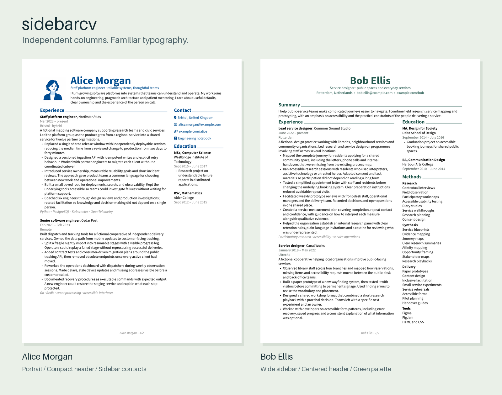

# SidebarCV

A flexible two-column theme for **RenderCV**. Start with a ready-to-use layout,
then choose which sections appear in the main column, sidebar, header or across
the full page. Customize your CV with ordinary RenderCV YAML.



**[Gallery and complete guide](https://Un1oR.github.io/rendercv-sidebarcv-theme/)** ·
[Example YAML](examples/) · [Tests](tests/README.md) · [License](LICENSE)

## Try it

Install [uv](https://docs.astral.sh/uv/getting-started/installation/), then:

```sh
uv tool install "rendercv[full]"
git clone https://github.com/Un1oR/rendercv-sidebarcv-theme.git
cd rendercv-sidebarcv-theme
cp examples/alice.yaml cv.yaml
cp examples/alice-portrait.png .
rendercv render cv.yaml
```

Open `rendercv_output/Alice_Morgan_CV.pdf`. Alice's compact layout combines a
blue portrait, a header summary and sidebar contacts, with Skills kept together
on page two. Try `examples/bob.yaml` for a wider sidebar whose method details
flow across pages, or `examples/john.yaml` for a complete CV rendered with only
`theme: sidebarcv` in its design, keeping each skill group intact. The original
RenderCV starter remains in `examples/starter.yaml`.

On Windows, use PowerShell `Copy-Item examples/alice.yaml cv.yaml` and
`Copy-Item examples/alice-portrait.png .` for the two copy commands.

## Use your own CV

Copy the **`sidebarcv/` directory** beside your input YAML and set:

```yaml
design:
  theme: sidebarcv
```

Then run `rendercv render your_cv.yaml`. Keep the theme beside the **input YAML**,
including when you load a separate design file. This follows RenderCV's
[official custom-theme mechanism](https://docs.rendercv.com/user_guide/how_to/override_default_templates/#method-2-create-a-custom-theme).

For example, choose where your summary, contacts and skills appear:

```yaml
design:
  theme: sidebarcv
  header:
    connections:
      placement: sidebar
  sections:
    overrides:
      summary:
        placement: header
      skills:
        stacked_details: true
        entries:
          allow_page_break: false
```

Use section names from your own YAML in `sections.overrides`. Names are matched
after lowercasing and replacing spaces with underscores: `Work Experience`
uses the key `work_experience`.

The [guide](https://Un1oR.github.io/rendercv-sidebarcv-theme/#reference) covers
placement, widths, page breaks, dates, vertical lists, tags and typography,
with editable examples and visual comparisons. Switch pages in the
[gallery](https://Un1oR.github.io/rendercv-sidebarcv-theme/#gallery) to see how
each layout continues, then use the compact
[page-break guide](https://Un1oR.github.io/rendercv-sidebarcv-theme/#pagination)
to choose a policy for your sections.

## Working with the theme

- SidebarCV supports standard RenderCV entries. Main and sidebar sections
  continue independently across pages.
- Turn grouped details into vertical lists, choose which groups receive initial
  capitals, and set page-break rules for whole sections or individual entries.
- For lighter emphasis, follow the
  [Semibold recipe](https://Un1oR.github.io/rendercv-sidebarcv-theme/#fonts).
- PDF and PNG use the SidebarCV layout. RenderCV also generates linear HTML and
  Markdown in YAML section order. A matching two-column HTML layout is a possible
  future improvement. Custom tags can be included by adapting the Markdown templates.
- To reuse the same content with different styles, store `cv:` and `design:` in
  separate files and select a design with `rendercv render cv.yaml --design design.yaml`.

Give your AI coding agent the repository URL and your existing CV, then ask it
to create a SidebarCV layout while preserving your factual content.

Tested with RenderCV 2.8. Compatibility with older versions has not been verified.

## Development

```sh
python -m venv .venv
# Activate .venv using the command for your shell.
python -m pip install -r requirements-dev.txt
python -m unittest discover -s tests -v
python docs/build_gallery.py
```

Tests also require Poppler (`poppler-utils` on Debian/Ubuntu). Their structure,
image comparison rules and baseline-update workflow are in
[`tests/README.md`](tests/README.md). The tests cover tricky layout cases and
multi-page CVs. Check your rendered CV and
[report issues](https://github.com/Un1oR/rendercv-sidebarcv-theme/issues) with a
small YAML example that shows the problem.

Theme code is MIT; optional fonts retain OFL 1.1. See
[`THIRD_PARTY_NOTICES.md`](THIRD_PARTY_NOTICES.md) for upstream attribution.
